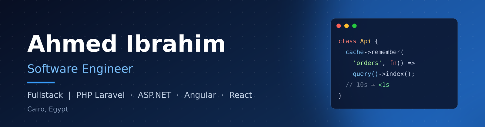
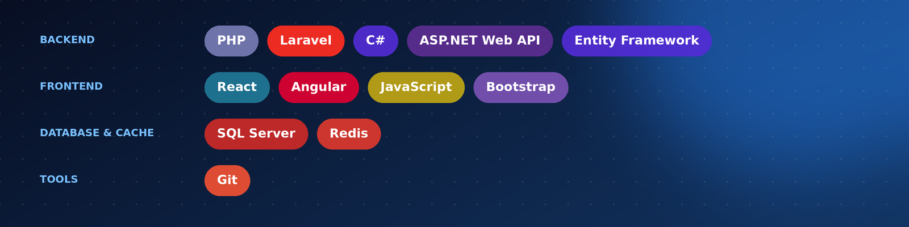

 

I build backend-heavy web applications with a focus on clean architecture and database performance. On one project I cut API response times from **~10s to under 1s** using query optimization, indexing, selective column loading, and Redis caching.

 

 

 

### POS & Inventory Management System
A full POS and inventory system built with **Laravel + React**.

| | |
|---|---|
| **Inventory** | FIFO/LIFO batch tracking with accurate returns, daily/monthly snapshots via Artisan commands |
| **Reliability** | Concurrency-safe transactions (`DB::transaction()` + `lockForUpdate()`), idempotency keys |
| **Finance** | Wallet/balance management using a ledger + materialized balance pattern |
| **Security** | Roles & permissions (Spatie), force-logout via Passport token revocation |
| **Operations** | Kiosk order management with print retry logic, React admin dashboard |
| **Architecture** | Service Layer, Repository, Strategy, Factory, Template Method |

[View repository](#)

 

- Going deeper into **C# / ASP.NET** and **SQL Server** (indexing, query tuning)
- Learning **Java / Spring Boot** as a longer-term second backend stack
- Improving my testing skills (unit tests, mocking, dependency injection)

 

 

**[LinkedIn](https://www.linkedin.com/in/ahmed-ebrahim4/)**  ·  **[Email](mailto:ahmed.ibrahim.dev1@gmail.com)**

 

